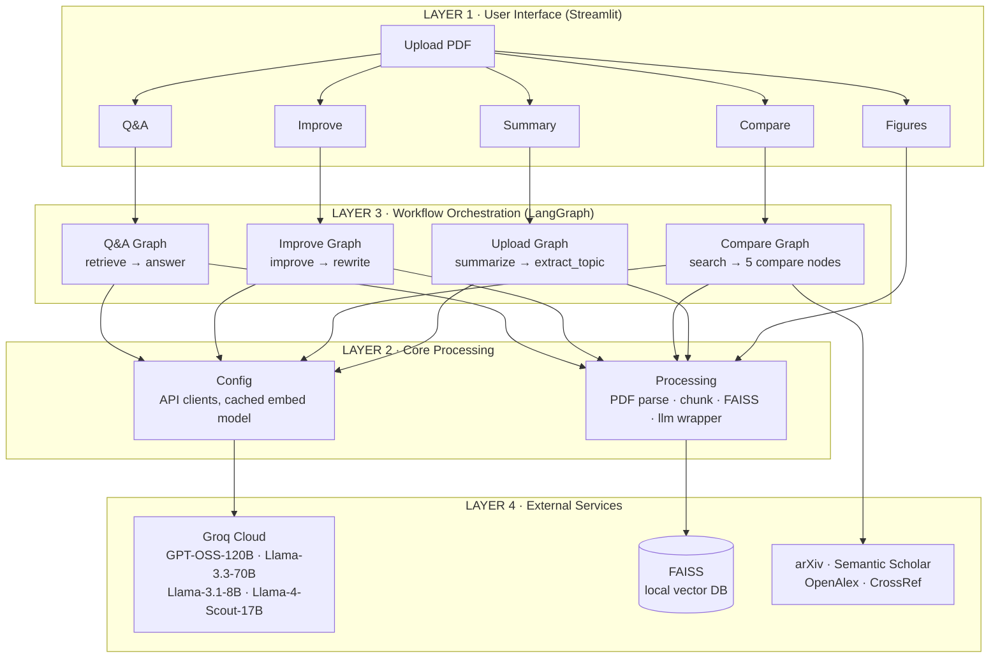
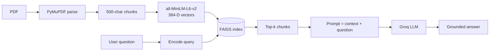

# 🔬 ScholarAI — Research Paper Analysis using Multimodal RAG and Agentic AI

> Upload a research paper. Get a technical summary, figure-by-figure vision analysis, grounded Q&A, a five-dimension comparison against live literature from four academic databases, and AI-rewritten sections for the weak parts — in minutes instead of hours.

<p align="left">
  
  
  
  
  
  
</p>

**B.Tech Final Year Project (BTP)** · Department of Electronics and Communication Engineering · The LNM Institute of Information Technology, Jaipur
Agastya Kundu · Ayush Negi · Siddharth Jain — under the guidance of **Dr. Vaibhav Kumar Gupta**

📄 **[Read the full project report →](docs/BTP_Report.pdf)**

---

## The problem

Thousands of papers are published every day. Researchers reach for ChatGPT or Gemini to make sense of them, and hit three walls:

| Wall | Why it happens | How ScholarAI fixes it |
| --- | --- | --- |
| **Hallucination** | The model answers from pre-trained memory, not from your paper | RAG grounds every answer in retrieved chunks of *your* uploaded PDF |
| **Knowledge cutoff** | The model has never seen papers published this year | Live queries to four academic APIs at request time |
| **Text-only reading** | Figures, charts and architecture diagrams are ignored | A vision-language model analyses every extracted figure |

Existing research assistants each solve part of this. Semantic Scholar and Connected Papers find related work but don't summarise or compare. Elicit summarises and finds similar papers but doesn't produce a dimension-by-dimension comparison or suggest concrete rewrites. ScholarAI does all five in one pipeline.

---

## What it does

**📋 Structured technical summary** — Six sections generated from the parsed PDF (Executive Summary, Problem & Motivation, Architecture & Methodology, Theoretical Contributions, Results & Benchmarks, Limitations), with explicit anti-hallucination constraints on numeric claims.

**🖼️ Vision figure analysis** — PyMuPDF extracts embedded images and filters out logos and banners by size (min 300×300 px) and aspect ratio (max 4:1). Surviving scientific figures go to Llama-4-Scout-17B, which returns figure type, key insights, and significance.

**💬 Grounded Q&A (RAG)** — The paper is chunked, embedded into 384-dimensional vectors with `all-MiniLM-L6-v2`, and indexed in a local FAISS store. Questions are encoded into the same space; the top-k nearest chunks become the only context the LLM is allowed to answer from. Nothing leaves your machine except the final prompt.

**🔍 Five-dimension comparative study** — Queries **arXiv, Semantic Scholar, OpenAlex and CrossRef** in parallel, merges up to 20 results, deduplicates by title slug, drops entries with missing or junk abstracts, and keeps the top 6. Five sequential LangGraph nodes then compare your paper against them on Problem & Objective, Methodology, Data & Evidence, Results & Findings, and Evaluation Method.

**✏️ Automated improvement pipeline** — Distills the comparison down to its technical core, identifies 3–5 *specific* weak sections (architectural justification, missing benchmarks, weak optimisation grounding — generic "improve clarity" feedback is explicitly forbidden by the prompt), and returns structured JSON rewrites rendered side-by-side against the original.

---

## Architecture

Four horizontal layers, with all analysis orchestrated as **four independent LangGraph state machines** sharing a single `PaperState` TypedDict.



### The RAG pipeline



### Engineering decisions worth calling out

- **Two-tier model fallback.** The central `llm()` wrapper truncates oversized prompts, calls GPT-OSS-120B, and on a `429` (rate limit) or `413` (payload too large) automatically retries against Llama-3.3-70B with a tighter character budget. The app degrades instead of failing.
- **Local vector DB, deliberately.** Unpublished manuscripts never get shipped to a hosted vector service. FAISS keeps retrieval sub-millisecond and the paper on disk.
- **Four search sources, not one.** arXiv covers CS preprints, Semantic Scholar carries rich metadata, OpenAlex has open-access breadth, CrossRef covers published journals. Together they return comparable literature regardless of the uploaded paper's domain.
- **Progressive query narrowing.** arXiv search retries with fewer keywords (all → 3 → 2) and finally falls back to relevance sort, so a niche topic still returns results instead of an empty list.
- **OpenAlex inverted-index reconstruction.** OpenAlex returns abstracts as a word→positions map; the code rebuilds readable prose from it.
- **Cached heavy resources.** `@st.cache_resource` loads the SentenceTransformer and compiles the four graphs exactly once per server session.
- **Context distillation.** Before the improvement pass, the ~5-section comparison is regex-sliced into five capped segments so the improvement prompt stays inside token limits without losing the analytical signal.

---

## Tech stack

| Category | Technology |
| --- | --- |
| UI | Streamlit |
| Orchestration | LangGraph (state-graph DAGs) |
| LLM inference | Groq Cloud |
| Primary LLM | `openai/gpt-oss-120b` |
| Fallback LLM | `llama-3.3-70b-versatile` |
| Fast LLM | `llama-3.1-8b-instant` |
| Vision LLM | `meta-llama/llama-4-scout-17b-16e-instruct` |
| Embeddings | `all-MiniLM-L6-v2` (384-D) |
| Vector DB | FAISS (CPU) |
| PDF processing | PyMuPDF (fitz) |
| Academic search | arXiv · Semantic Scholar · OpenAlex · CrossRef |
| Config | python-dotenv |

---

## Quickstart

**Prerequisites:** Python 3.10+ and a free [Groq API key](https://console.groq.com/keys). The four academic APIs are public — no keys needed.

```bash
# 1. Clone
git clone https://github.com/Agastya51/ScholarAI.git
cd ScholarAI

# 2. Virtual environment
python -m venv venv
source venv/bin/activate      # macOS / Linux
venv\Scripts\activate         # Windows

# 3. Install
pip install -r requirements.txt

# 4. Add your key
cp .env.example .env          # then edit .env and paste your Groq key

# 5. Run
streamlit run app.py
```

The app opens at `http://localhost:8501`.

> **First run is slow.** `sentence-transformers` downloads the ~90 MB embedding model once, then caches it.

### Using it

1. Upload a PDF in the sidebar and hit **🚀 Analyze Paper** — this runs the Upload Graph (summary + topic extraction) and builds the FAISS index.
2. **Summary** and **Figures** are available immediately.
3. **Q&A** works as soon as the index is built.
4. **Compare** takes 30–60 s (four API calls plus five LLM comparison nodes).
5. **Improve** requires Compare to have run first — it consumes the comparison output.

---

## Project structure

```
ScholarAI/
├── app.py              # Streamlit UI — 5 tabs, session state, graph invocation
├── config.py           # Groq client, model IDs, cached embedding model
├── utils.py            # llm() wrapper w/ fallback, PDF parse, chunking, FAISS, distillation
├── graphs.py           # PaperState + all LangGraph nodes and the 4 compiled graphs
├── api_search.py       # arXiv, Semantic Scholar, OpenAlex, CrossRef clients
├── requirements.txt
├── .env.example
├── docs/
│   ├── ARCHITECTURE.md # Deep technical walkthrough
│   └── BTP_Report.pdf  # Full project report
└── README.md
```

📐 **[Full architecture walkthrough →](docs/ARCHITECTURE.md)**

---

## Screenshots

<!-- Replace these with real screenshots — see GITHUB_UPLOAD_GUIDE.md step 9 -->

| Summary | Figures | Compare |
| --- | --- | --- |
| _add `docs/images/summary.png`_ | _add `docs/images/figures.png`_ | _add `docs/images/compare.png`_ |

---

## Limitations & future work

- Summarisation reads the first 8,000 characters of the paper; very long papers are truncated.
- Chunking is fixed-size (500 chars) without overlap in the current implementation — recursive overlapping chunks are the planned upgrade.
- Figure analysis relies on embedded raster images; vector-drawn figures and pure-text tables are not captured.
- Comparison quality depends on abstract availability; CrossRef records without abstracts are filtered out.
- Planned: writing accepted rewrites back into the source PDF, citation-graph traversal, and multi-paper batch comparison.

---

## License

MIT — see [LICENSE](LICENSE).

## Acknowledgements

Dr. Vaibhav Kumar Gupta for supervision, and the arXiv, Semantic Scholar, OpenAlex and CrossRef teams for keeping their APIs open and free.
