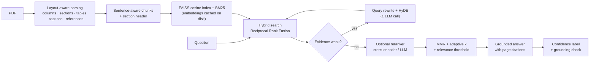

# 🔬 ScholarAI — Research Paper Analysis using Multimodal RAG and Agentic AI

> Upload a research paper. Get a grounded summary, every figure explained in the context of the text that discusses it, answers whose citations open the exact page with the passage highlighted, a peer review, related work from four academic databases, and fact-checked rewrites of the weak parts.

<p align="left">
  
  
  
  
  
  
</p>

**B.Tech Final Year Project (BTP)** · Department of Electronics and Communication Engineering · The LNM Institute of Information Technology, Jaipur
Agastya Kundu · Ayush Negi · Siddharth Jain — under the guidance of **Dr. Vaibhav Kumar Gupta**

📄 **[Read the full project report →](docs/BTP_Report.pdf)** · 📐 **[Architecture walkthrough →](docs/ARCHITECTURE.md)**

Powered by **Groq** (`openai/gpt-oss-120b` with automatic fallback to `llama-3.3-70b-versatile`, plus `meta-llama/llama-4-scout-17b-16e-instruct` for vision), **FastEmbed** (`BAAI/bge-small-en-v1.5`), **FAISS**, **PyMuPDF**, and **LangGraph**, served by **Flask**.

---

## The problem

Thousands of papers are published every day. Researchers reach for general chatbots to make sense of them, and hit four walls:

| Wall | Why it happens | How ScholarAI addresses it |
| --- | --- | --- |
| **Hallucination** | The model answers from pre-trained memory, not from your paper | Hybrid retrieval grounds every answer in passages of *your* PDF; each answer carries an evidence-strength label and flags numbers that are not in the passages |
| **Unverifiable citations** | A page number is easy to invent | Every citation opens the real page of the PDF with the passage highlighted |
| **Knowledge cutoff** | The model has never seen this year's papers | Live queries to arXiv, Semantic Scholar, OpenAlex and CrossRef |
| **Text-only reading** | Figures are ignored, or explained without the text that discusses them | Figures (including vector plots) are joined with their caption and every sentence that cites them before a vision model explains them |

---

## ✨ What it does

| Page | What happens |
|---|---|
| **Overview** (`/`) | Layout-aware PDF parsing, hybrid indexing, grounded summary, the same paper explained for a beginner, a student or an expert, read-aloud |
| **Figures** (`/figures`) | Every figure (bitmap or vector) shown with its caption, the sentences of the paper that discuss it, a grounded explanation, and a box to ask about it |
| **Ask** (`/qa`) | Tool-using research agent or quick single-call RAG; answers cite pages, show an evidence badge, and every citation opens the real page with the passage highlighted |
| **Study** (`/study`) | Claims with quoted evidence (each quote is searched for in the paper and marked found / close / not found), key terms, flashcards, quiz |
| **Related work** (`/compare`) | Self-correcting literature search over ArXiv, Semantic Scholar, OpenAlex, CrossRef + comparative study |
| **Peer review** (`/review`) | Parallel reviewers (methodology, novelty, reproducibility, clarity) + meta-review |
| **Improve writing** (`/improve`) | Critique → rewrite → fact-check → revise loop; rewrites are marked fact-checked or flagged |
| **Run everything** (`/analyze`) | Supervisor routes specialist agents toward a goal, streamed live, with human approval checkpoints |
| **Compare papers** (`/library`) | Compare 2–5 uploaded papers in a matrix |
| **Export** (`/download`) | Markdown notes, PDF report, edited PDF |
| **Benchmarks** (`/benchmarks`) | Latest results of the benchmark suite |

### How this differs from a general notebook assistant

- **Verifiable citations.** A page reference opens that page of the PDF, rendered by the server, with the cited passage highlighted (`src/viewer.py`).
- **Figures are read in context.** See the next section.
- **Quotes are checked, not trusted.** Evidence quotes in the Study page are matched against the paper's text without an LLM (`src/study.py: locate_quote`).
- **A critical reader, not only a summariser.** Peer-review panel, fact-checked rewrites, evidence-strength ratings, and a runtime grounding check on every answer.
- **Measured.** A reproducible benchmark with confidence intervals ships with the project.

---

## 🖼️ Figure understanding

A figure is three things that are often far apart in a PDF: the picture, its caption, and the sentences that explain it. `src/figures.py` joins them before any model is asked to explain anything.

1. **Find the picture from its caption.** For each `Fig. N` / `Figure N` caption, the graphics above it (or below it) are collected: embedded bitmaps *and* clusters of vector drawings. Sub-plots are chained into one region, short text inside the region (axis titles, tick labels, legends) is included, and the region is rendered to an image. Vector plots, which contain no bitmap at all, are therefore handled too.
2. **Follow the caption across a page break.** If the caption's own page has no graphics, the largest unclaimed figure on the previous or next page is used.
3. **Collect every mention.** All sentences that refer to the figure (`Fig. 3`, `Figs. 2 and 3`, `Figures 2–4`, `Figure 5(a)`) are gathered with their page and section, plus the sentence that follows each.
4. **Explain with all three.** The vision model receives the image, the caption and the mentions, and is asked to say what the figure is, how to read it, what it shows, why it matters in the paper, and whether the picture supports what the text claims.
5. **Degrade honestly.** If the vision model is unavailable, a text-only explanation is written from the caption and mentions and labelled as such; errors are never cached as explanations.
6. **Reuse.** An explanation is added to the search index, questions that name a figure ("What does Fig. 2 show?") look at that figure directly, and the agent's `analyze_figure` tool accepts a specific question.

Axis labels and legends are kept out of the running text, so they no longer pollute paragraphs or search results.

---

## 🔍 RAG pipeline



**Document understanding** (`src/rag.py`)

- **Column-aware reading order** — two-column pages (IEEE/ACM style) are read left column then right column, within bands delimited by full-width blocks (title, abstract, wide figures).
- **Section + subsection anchors** — headings such as `3.1 Training Details` are recognised even when the PDF stores the number and the title as separate fragments; chunks carry anchors like `[p. 4 · 3 Method › 3.1 Training Details]`.
- **Figure ↔ caption linking** — each extracted image is matched to its `Fig. N` / `Figure N` caption on the same page, or on the next/previous page when the caption was pushed over a page break. The caption is given to the vision model and is indexed as its own chunk.
- **Tables** — detected with PyMuPDF, read cell by cell (keeps decimal points intact), stored as markdown with their caption, and removed from the running prose so they are not indexed twice.
- **Reference list** — parsed into numbered entries (`get_reference` tool) and kept out of normal search so bibliography entries do not crowd out real content.
- **Text clean-up** — ligatures (`fi` → `fi`) and line-end hyphenation are undone so keyword search matches.

**Retrieval** (`src/retrieval.py`)

- **Hybrid search** — BM25 + dense cosine similarity fused with Reciprocal Rank Fusion.
- **Contextual chunk headers** — each chunk is indexed as `<section>: <text>`.
- **MMR** — picks passages that are relevant *and* not redundant.
- **Adaptive k + relevance threshold** — reads wider when evidence is weak, drops passages that are neither semantically close nor a keyword match.
- **Corrective query expansion** — when the first pass has low confidence, one LLM call rewrites the question and writes a hypothetical answer passage (HyDE); results are fused with the original query.
- **Optional reranking** — `RERANK_MODE=cross-encoder` (small ONNX cross-encoder) or `llm` (listwise).
- **Runtime quality signals** — every answer returns a confidence label (`high` / `medium` / `low`) and a grounding check (numbers and page citations in the answer that are not in the retrieved passages). Both are shown in the Q&A page.
- **Embedding cache** — vectors are stored on disk by content hash, so re-uploading the same PDF skips embedding.

All switches are in `src/config.py` and can be set from `.env` (see `.env.example`).

---

## 📏 Evaluation

Three scripts in `evals/` (details and plain-language metric definitions in [`evals/README.md`](evals/README.md)):

```bash
# 1. Retrieval ablation — no API key needed
python -m evals.retrieval_eval --paper evals/sample/sample_paper.pdf --dataset evals/datasets/sample_paper.json

# 2. Draft a question set for your own paper (needs GROQ_API_KEY), then review it
python -m evals.generate_dataset --paper my_paper.pdf --n 15 --unanswerable 4 --out evals/datasets/my_paper.json

# 3. End-to-end answers: naive RAG vs upgraded pipeline vs agent (needs GROQ_API_KEY)
python -m evals.run_eval --paper my_paper.pdf --dataset evals/datasets/my_paper.json --judge --sleep 3
```

| Script | Measures |
|---|---|
| `retrieval_eval` | Hit rate, MRR, context recall, precision, nDCG for `bm25` → `dense` → `hybrid` → `hybrid+mmr` → `pipeline` (→ reranker / expansion), plus a similarity-score calibration that suggests `MIN_RELEVANCE` / `HIGH_CONFIDENCE` |
| `run_eval` | Fact recall, context recall, citation rate and precision, hallucinated numbers, abstention on unanswerable questions, LLM calls and latency; with `--judge` also faithfulness, relevance, correctness |
| `generate_dataset` | Drafts questions whose answer key must literally occur in the source passage |

### Benchmark suite

```bash
python -m evals.benchmark download                         # fetch three arXiv papers (once)
python -m evals.benchmark run                              # retrieval + speed, no API key
python -m evals.benchmark run --answers --judge --sleep 3  # also answer quality (needs GROQ_API_KEY)
```

The suite is *Attention Is All You Need*, *BERT* and *ResNet* with 42 answerable and 9 unanswerable hand-written questions; every answer key was checked against the paper text. The runner reports pooled retrieval metrics with 95% bootstrap confidence intervals, parsing statistics (figures found, with caption, cited in text), indexing time and search latency. Questions whose answer key is not found in the downloaded PDF are reported and excluded rather than silently scored as failures. Results are written to `evals/benchmark/latest.json` and shown on the **Benchmarks** page; commit that file to show them on a deployed copy.

Reports are written to `evals/results/` as Markdown and JSON. `evals/sample/` contains a small **synthetic** paper (invented content) so the scripts can be tried immediately; numbers worth reporting must come from real papers.

---

## 🤖 Agentic architecture

| Feature | Where | Pattern |
|---|---|---|
| Q&A agent | `/qa`, `agents/qa_agent.py` | ReAct tool loop (paper search, sections, tables, figures, references, external literature), capped iterations, `[p. N]` citations |
| Literature scout | `/compare`, `workflows.py` | search → LLM relevance grader → reformulate keywords → search (max 3 attempts) |
| Rewrite fact-checker | `/improve`, `workflows.py` | evaluator-optimizer: critic + number/anchor checks → revise failing edits (max 2 rounds) → verified / flagged |
| Peer-review panel | `/review`, `agents/review_panel.py` | parallel fan-out with `Send`, structured reviews, meta-review decision |
| Supervisor | `/analyze`, `agents/supervisor.py` | LLM router over specialist agents toward a user goal; SSE streaming; `interrupt` checkpoints (keywords, rewrites) |
| Multi-paper synthesis | `/library`, `agents/multi_paper.py` | parallel profiling of 2–5 papers → comparison matrix + narrative |

Every response carries an agent `trace` and an `llm_calls` count, shown as a collapsible panel in the UI. Budgets (`MAX_LLM_CALLS_PER_RUN`, `MAX_LLM_CALLS_ANALYZE`) stop runaway loops from exhausting Groq rate limits.

---

## 🏗️ Repository layout

```
ScholarAI/
├── run.py                  # Local launcher (`python run.py`)
├── Procfile                # Production launcher (gunicorn)
├── docs/                   # BTP_Report.pdf, ARCHITECTURE.md
├── src/
│   ├── app.py              # Flask routes, per-browser sessions, upload validation, /health
│   ├── config.py           # Models, retrieval switches, budgets, session and upload limits
│   ├── llm.py              # chat() with tool calling, structured() output, typed errors, usage tracking
│   ├── rag.py              # PDF parsing, chunking, hybrid VectorStore, embedding cache, PaperLibrary, sessions
│   ├── retrieval.py        # Query expansion, reranking, MMR/threshold pipeline, confidence, grounding check
│   ├── figures.py          # Figure regions (bitmap + vector), captions across pages, in-text mentions, grounded explanation
│   ├── viewer.py           # Renders a PDF page with the cited passage / figure / table highlighted
│   ├── study.py            # Claims with verified quotes, glossary, flashcards, quiz, explain-at-level, starter questions
│   ├── search.py           # 4-engine scholarly search, enrichment, reranking, paper lookup
│   ├── tools.py            # Tool registry exposed to agents
│   ├── workflows.py        # Upload graph, self-correcting search loop, rewrite loop, fast RAG Q&A
│   ├── agents/             # base (ReAct), qa_agent, review_panel, supervisor, multi_paper
│   ├── pdf_builder.py      # PDF report synthesis
│   ├── static/             # app.css, app.js, bundled fonts and libraries (no CDN requests)
│   └── templates/          # upload, figures, qa, study, compare, improve, review, analyze, library, download, benchmarks
├── evals/
│   ├── retrieval_eval.py   # Retrieval ablation + score calibration (no LLM)
│   ├── run_eval.py         # Answer evaluation: naive vs pipeline vs agent
│   ├── benchmark.py        # Multi-paper benchmark suite (download / run), publishes to the Benchmarks page
│   ├── benchmark/          # suite.json, question sets for three arXiv papers, latest.json (after a run)
│   ├── generate_dataset.py # LLM-drafted question sets with a literal answer key
│   ├── metrics.py          # Metric definitions
│   ├── pipelines.py        # The three answering pipelines being compared
│   ├── datasets/           # example.json, sample_paper.json
│   └── sample/             # Synthetic sample paper (PDF + LaTeX source)
└── tests/                  # Unit + agent + parsing + retrieval + session + eval tests (fake LLM, no network)
```

---

## 🚀 Getting started

**Prerequisites:** Python 3.10 or newer (tested on 3.13) and a [Groq API key](https://console.groq.com/).

```bash
git clone https://github.com/Agastya51/ScholarAI.git
cd ScholarAI

# Windows (PowerShell)
python -m venv venv
.\venv\Scripts\Activate.ps1
# macOS / Linux
python3 -m venv venv && source venv/bin/activate

pip install -r requirements.txt

# Windows: copy .env.example .env      macOS / Linux: cp .env.example .env
# then put your key in .env:  GROQ_API_KEY=gsk_...

python run.py          # open http://127.0.0.1:5000
```

The first start downloads the embedding model (about 70 MB) once.

## 🧪 Tests

```bash
python -m unittest discover -s tests
```

The tests use a scripted fake LLM and a toy embedder, so they need no Groq key. One test that loads the real embedding model is skipped when the model cannot be downloaded.

---

## ☁️ Deployment (Render or any host that runs a Procfile)

1. Push the repository to GitHub.
2. Create a **Web Service** from the repo. Build command: `pip install -r requirements.txt`. Start command: taken from `Procfile`.
3. Set environment variables: `GROQ_API_KEY` (required), `FLASK_DEBUG=False`. `PORT` is provided by the host.
4. Set the health-check path to `/health`.

Things to know:

- **Keep one worker** (`--workers 1` in the `Procfile`). Paper indexes live in the memory of the worker process, so a second worker would not see papers uploaded through the first.
- **Each browser gets its own paper library** through an anonymous cookie. Idle libraries expire after `SESSION_TTL_SECONDS`, and the least recently used ones are dropped beyond `MAX_SESSIONS`; their uploaded files are deleted with them.
- **A restart clears uploads.** Users re-upload their paper; if the disk survived, the embedding cache makes that fast.
- **One request at a time.** The default single-threaded worker protects a 512 MB instance; a long `/analyze` run makes other users wait. Raise `--threads` only on a larger instance.
- Leave `RERANK_MODE=none` on small instances; the cross-encoder loads a second model.

---

## ⚠️ Known limitations

**Retrieval**
- The embedding model is general-purpose (`bge-small-en-v1.5`), not fine-tuned on scientific text.
- `MIN_RELEVANCE` / `HIGH_CONFIDENCE` are defaults; calibrate them once for your papers with `evals.retrieval_eval`.
- Fast RAG mode does one corrective retry, not true multi-hop retrieval. Questions that chain evidence across sections are handled by the agent mode, which searches iteratively.
- Reranking is off by default. Query expansion runs only when evidence is weak.
- A changed PDF is re-indexed from scratch (identical content is served from the embedding cache).

**Document understanding**
- Mathematical notation loses its formatting (superscripts, subscripts, fractions).
- Column detection handles one- and two-column pages; three or more columns fall back to PDF order.
- Figures are located from their captions. A figure with no "Fig. N" caption is found only if it is a bitmap; an uncaptioned vector drawing is not.
- Figure regions come from layout heuristics. Unusual layouts (a caption beside the figure, or a short left-aligned caption under a full-width figure in a two-column paper) can crop or miss a figure.
- At most 12 figures are extracted per paper, and the first 3 are explained during upload; the rest are explained on demand from the Figures page.
- Figure explanations are written by a vision model. Values it reads from a plot are estimates.
- Scanned PDFs without a text layer are rejected (no OCR).
- Table detection depends on PyMuPDF; tables it misses stay in the text as rows.
- In-place redaction of the original PDF is fragile on multi-column layouts.

**Infrastructure**
- LLM calls are synchronous; there is no response caching, and only `/analyze` streams.
- Paper libraries are in memory: no database, no user accounts, single worker.
- Analysis results shown in the pages live in the browser's `sessionStorage`.
- FAISS uses an exact flat index. That is the right choice for single papers (hundreds of chunks); it would need an approximate index only for very large libraries.

**Study material and the page viewer**
- Quote checking is literal. A correct paraphrase is reported as "close match" or "not found", so "not found" means unverified, not necessarily wrong.
- Flashcards and quiz questions are model-written; only their page numbers and numbers are sanity-checked.
- Highlighting searches the PDF's text layer for short runs of words. Passages with heavy maths or unusual fonts may be only partly highlighted.
- Read-aloud uses the browser's built-in speech synthesis.

**Evaluation**
- The benchmark suite is three papers and 51 questions: enough to compare retrieval settings, too small for fine distinctions (see the confidence intervals).
- Fact matching is exact-substring, so a correct paraphrase of a fact can be scored as a miss; the optional LLM judge covers paraphrases but is itself a model.
- Auto-generated question sets must be reviewed by a person before the numbers are reported.

---

## 🔒 Security

- Never commit `.env`; it is listed in `.gitignore`.
- Uploads are limited by size (`MAX_UPLOAD_MB`) and page count (`MAX_PDF_PAGES`), must start with a PDF signature, and are stored under server-generated names.
- Session cookies are random, `HttpOnly`, `SameSite=Lax`, and carry no personal data.
- Model output is rendered through DOMPurify before it reaches the page.
- The interface makes no third-party requests: fonts and scripts are served from `src/static/`.

## Credits

Bundled in `src/static/`: [marked](https://github.com/markedjs/marked) (MIT), [DOMPurify](https://github.com/cure53/DOMPurify) (MPL-2.0 / Apache-2.0), and the Newsreader and Instrument Sans typefaces (SIL Open Font License 1.1).

## License

MIT — see [LICENSE](LICENSE).

## Acknowledgements

Dr. Vaibhav Kumar Gupta for supervision, and the arXiv, Semantic Scholar, OpenAlex and CrossRef teams for keeping their APIs open and free.
