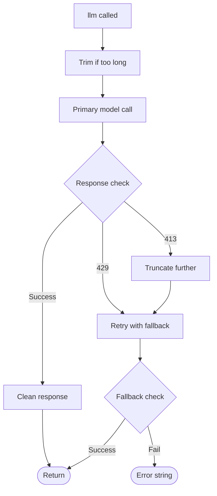
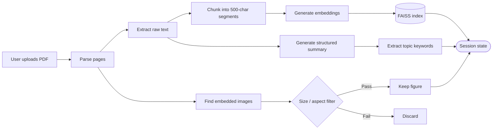
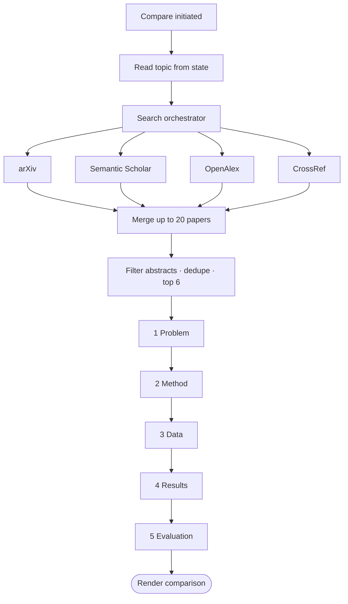

# ScholarAI — Architecture

A technical walkthrough of how the system is put together. For the high-level pitch, see the [README](../README.md); for the full academic treatment, see [BTP_Report.pdf](BTP_Report.pdf).

---

## 1. Design principles

**Separation of concerns.** Configuration, document processing, workflow orchestration, academic search and UI live in five separate modules that communicate only through public function signatures. No module reaches into another's internals, so each can be tested or swapped independently.

**Stateful workflow orchestration.** Rather than one monolithic analysis function, each step is a named node on a directed graph. A shared `PaperState` dict flows through the graph, accumulating results. Adding a step means adding a node and an edge — the execution path stays inspectable and each node is debuggable in isolation.

**Graceful degradation.** Cloud LLM endpoints rate-limit under load. The LLM interface has an automatic two-tier fallback so a `429` or `413` from the primary model doesn't surface as an error to the user.

**Local vector search.** RAG runs entirely against a local FAISS index. Unpublished manuscripts never touch a hosted vector database, and retrieval latency is sub-millisecond.

**Multi-source retrieval.** Comparative analysis queries four academic databases with different coverage footprints, then merges and deduplicates, so results hold up across disciplines.

---

## 2. Layered structure

| Layer | Responsibility | Files |
| --- | --- | --- |
| **1 — Interface** | Streamlit app: sidebar upload, five tabs, session-state caching of every generated result | `app.py` |
| **2 — Core processing** | Model config, PDF parsing, chunking, embedding, FAISS index, the `llm()` routing wrapper, context distillation | `config.py`, `utils.py` |
| **3 — Orchestration** | Four compiled LangGraph DAGs and their nodes | `graphs.py` |
| **4 — External services** | Groq inference, four academic APIs, local FAISS storage and temp image assets | `api_search.py` + service calls |

Session state is the thing that makes the UI feel fast: parsed text, chunk vectors, the FAISS index object, retrieved papers and each comparison section are all cached, so switching tabs never re-triggers an LLM call or an API round-trip.

---

## 3. Module design

### 3.1 Configuration (`config.py`)

Single entry point for model initialisation. Reads `GROQ_API_KEY` from the environment via `python-dotenv`, constructs the Groq client, and declares the four model IDs.

| Model | Role | Rationale |
| --- | --- | --- |
| `openai/gpt-oss-120b` | Primary text generation | Highest reasoning quality for summarisation and comparison |
| `llama-3.3-70b-versatile` | Fallback text generation | Strong backup when the primary is rate-limited |
| `llama-3.1-8b-instant` | Fast pipeline tasks | Cheap, quick topic extraction |
| `meta-llama/llama-4-scout-17b-16e-instruct` | Vision analysis | Multimodal, handles charts and architecture diagrams |

The embedding model (`all-MiniLM-L6-v2`, 384-D) is wrapped in `@st.cache_resource`, so the ~90 MB checkpoint loads from disk once per server session rather than on every interaction.

### 3.2 Document processing (`utils.py`)

**PDF parsing.** PyMuPDF walks pages, concatenating extracted text and pulling every embedded image object by xref. Two filters keep the figure set clean:

- minimum 300 × 300 px — drops university logos and UI icons
- maximum 4:1 aspect ratio in either direction — drops "Published online…" banner strips

Survivors are written to the OS temp directory as PNGs and their paths returned alongside the text.

**Chunking.** Text is split into 500-character segments. 500 is the sweet spot: shorter chunks lose the context needed to answer a question, longer ones dilute the embedding vector and degrade retrieval precision. A typical paper yields 80–160 chunks.

**Embedding & storage.** Chunks are batch-encoded to 384-D vectors and added to a flat FAISS index held in session state.

**Semantic retrieval.** The query is encoded into the same space; FAISS returns the k nearest chunks (k = 3 by default, clamped to the corpus size).

**The `llm()` wrapper.** The central API routing function, and the most defensive piece of code in the project:

1. Truncates prompts over 24,000 characters before sending.
2. Appends a mandatory math-formatting rule (`$$` / `$`, never `\[ \]`) so output renders correctly in Streamlit's markdown.
3. Calls the primary model at `temperature=0.3`, `max_tokens=4000`.
4. Strips accidental system-instruction leakage from the response with regex.
5. Unless `disable_failsafe=True`, trims a truncated response back to its last complete sentence.
6. On exception, inspects the error string — if it contains `429`, `413` or `limit`, retries against the fallback model (with a 10,000-char budget for `413`). Otherwise returns a readable error string rather than raising.

**Context distillation.** Before the improvement pass, `distill_context()` regex-extracts each of the five comparison sections, caps each at 1,200 characters, and relabels them (`PROBLEM GAPS`, `METHODOLOGY SHORTFALLS`, …). If the parse fails it falls back to the first 3,000 characters. This keeps the improvement prompt inside token limits while preserving the analytical signal.

### 3.3 Academic search (`api_search.py`)

Four independent clients, each returning a normalised dict (`title`, `summary`, `year`, `link`, `venue`):

- **arXiv** — Atom API. Implements *progressive narrowing*: builds a boolean `AND` query from all keywords sorted by submission date, and if that returns nothing, retries with the first 3 keywords, then 2, then finally the raw query sorted by relevance. Responses are parsed with regex rather than an XML dependency.
- **Semantic Scholar** — Graph API, requesting `title,abstract,year,url,venue`.
- **OpenAlex** — returns abstracts as an `abstract_inverted_index` (word → list of positions). The client rebuilds readable prose by sorting `(position, word)` pairs, capped at 1,500 characters.
- **CrossRef** — REST API for published journal metadata. Abstracts are usually absent, so most CrossRef hits are filtered out downstream by the abstract-quality check — they contribute mainly on the domains where the other three are thin.

Every network call is wrapped in try/except with an explicit timeout; a failing source returns `[]` instead of breaking the pipeline.

### 3.4 Orchestration (`graphs.py`)

Every node receives and returns the shared `PaperState` TypedDict, which carries: `text`, `images`, `chunks`, `summary`, `vision`, `topic`, `papers`, the five `comp_*` sections, `improvements`, `edits`, `query`, `answer`, `error`.

All node prompts follow the same template — **role**, **task**, **constraints**, **context** — which measurably reduces both hallucination and format drift. The comparison prompts in particular forbid meta-commentary, "bottom lines" and hypothetical examples, and mandate a paper-by-paper structure with bold subheadings.

---

## 4. The four execution graphs

### 4.1 Upload Graph — `summarize → extract_topic → END`

`node_summarize` sends the first 8,000 characters of the paper under a "Technical Reviewer" role with six mandated sections and an explicit rule against inventing metrics. `node_extract_topic` then reduces that summary to 3–4 bare keywords, which become the global search string for the comparison stage.

In parallel with the graph, the app chunks the text, builds the FAISS index and stores the filtered figure paths.

### 4.2 Compare Graph — `arxiv_search → compare_problem → compare_method → compare_data → compare_results → compare_eval → END`

`node_arxiv_search` fans out to all four APIs, concatenates up to ~20 results, then filters:

1. Drop any paper whose abstract is missing, under 100 characters, or contains a "no abstract available" marker — this is what stops the comparison LLM from filling the table with "Not Reported".
2. Deduplicate on an alphanumeric slug of the title.
3. Keep the top 6.

Five sequential nodes then each compare the original paper against those six on one dimension, running with `disable_failsafe=True` so structured markdown output isn't truncated mid-list.

Splitting comparison into five separate LLM calls rather than one is deliberate: each call gets the full token budget for its dimension, a rate-limit failure only costs one section, and the UI can render sections as they complete.

### 4.3 Improve Graph — `improve → rewrite → END`

`node_improve` runs the distilled comparison plus the first 5,000 characters of the paper through a "Senior Technical Editor" role that is explicitly barred from generic feedback and required to cite the comparative analysis. `node_rewrite` then asks for a strict JSON array of `{section, original, rewritten}` objects, max 5.

JSON parsing is layered: strip markdown fences → regex-extract the outermost `[...]` → `json.loads` → deduplicate by section name. Both a failed regex match and a parse exception produce a structured error object rather than a crash, so the UI always has something to render.

### 4.4 Q&A Graph — `qa → END`

Encode the question → FAISS top-3 retrieval → join chunks as context → answer under an instruction to use only that context. Three steps, one node, and the reason answers stay grounded.

### 4.5 Figure analysis

Outside the graphs, `analyze_single_image()` base64-encodes a figure and sends it to the vision model with a three-part prompt (type / key insights / importance). Results are memoised in a `vision_dict` keyed by figure index, so re-renders never re-bill an API call. Figures can be analysed individually or in bulk.

---

## 5. Design decisions and rationale

**Why state-graph orchestration over a linear script?** Explicit execution structure, clean context separation, and fault isolation per node. A failure in `compare_data` doesn't take down `compare_results`.

**Why a local vector database?** Hosted vector DBs add network latency, per-query cost, and data-privacy exposure. Uploaded manuscripts are frequently unpublished and sometimes proprietary; FAISS keeps them on disk and returns results in under a millisecond.

**Why four academic databases?** Their coverage footprints barely overlap. arXiv is deep on computing preprints but thin elsewhere; Semantic Scholar has the richest metadata; OpenAlex has open-access volume; CrossRef indexes published journals. Together they return a usable comparison set no matter what domain the uploaded paper belongs to.

**Why 500-character chunks?** Below 500, chunks lose the surrounding context that makes a retrieved passage answerable. Above 500, the embedding vector averages over too many ideas and retrieval precision drops.

**Why five separate comparison calls?** Token budget per dimension, partial-failure containment, and progressive rendering.

**Why prompt-level anti-hallucination constraints?** The summariser is explicitly forbidden from inventing metrics, formulas or scores; the comparison nodes are told to write "Not Reported" rather than guess. Combined with abstract-quality filtering upstream, this is what keeps the comparison tables honest.

---

## 6. Known limitations

| Limitation | Cause | Path forward |
| --- | --- | --- |
| Long papers are truncated | Summariser reads first 8,000 chars | Hierarchical / map-reduce summarisation |
| No chunk overlap | Fixed-size 500-char split | Recursive character splitting with overlap |
| Vector figures missed | Only embedded raster images are extracted | Page-region rendering for vector graphics |
| CrossRef hits mostly filtered | REST API rarely exposes abstracts | Supplement with Unpaywall / OpenAlex join |
| Rewrites not written back to PDF | Not yet implemented | PyMuPDF in-place text replacement |
| Session state is per-browser-session | Streamlit's execution model | Persistent index store keyed by document hash |
